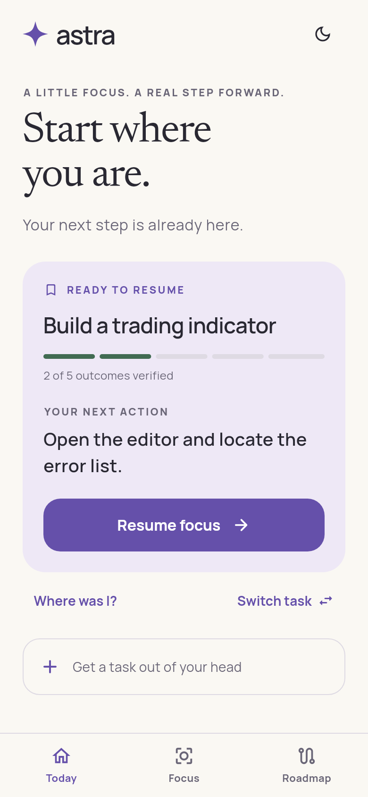
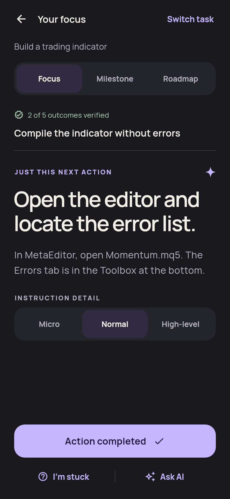
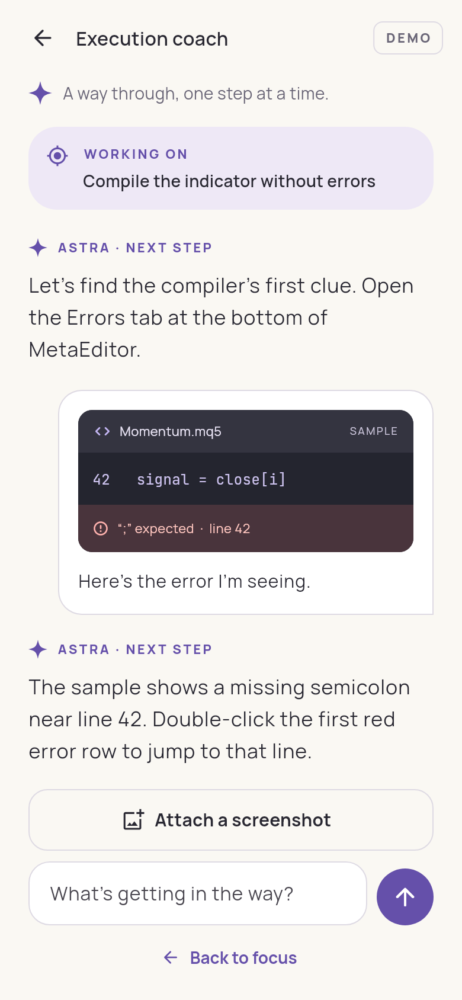
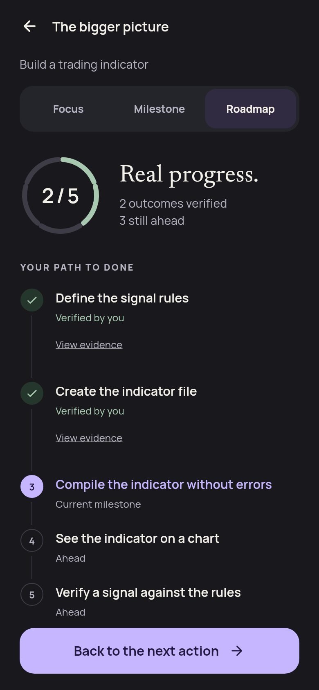
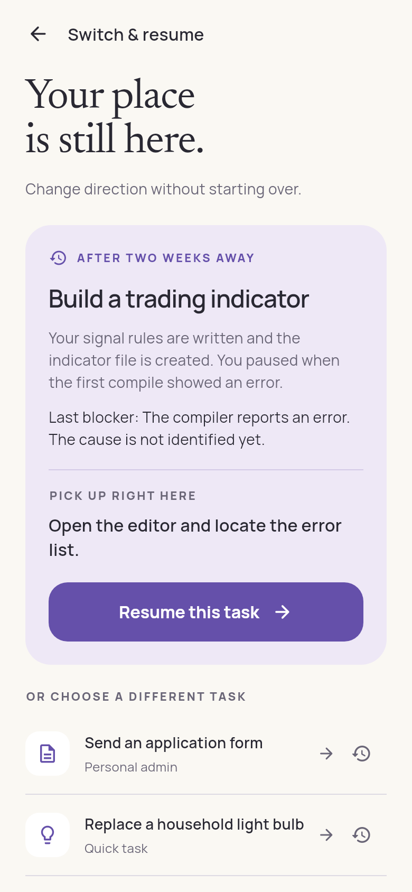

# Astra screen gallery

Actual Flutter renders at **390 × 844 logical pixels**, exported as 780 × 1688 PNGs. These are not Android device captures. The screenshot test loads the same bundled fonts as the app.

| Screen | Light | Dark |
| --- | --- | --- |
| Home / Resume | [PNG](home-light.png) | [PNG](home-dark.png) |
| Focus / Next action | [PNG](focus-light.png) | [PNG](focus-dark.png) |
| Execution coach / Screenshot | [PNG](coach-light.png) | [PNG](coach-dark.png) |
| Project roadmap | [PNG](roadmap-light.png) | [PNG](roadmap-dark.png) |
| Switching / Two-week recovery | [PNG](recovery-light.png) | [PNG](recovery-dark.png) |

 

  

Regenerate from `prototypes/astra` with:

```sh
flutter test test/render_test.dart --dart-define=EXPORT_SCREENSHOTS=true
```
