# Astra · Three visual directions

A review study on `design/astra-visual-exploration`, based on `design/astra-concept`. No final identity has been selected.

Open **[the interactive comparison gallery](index.html)** in a browser after downloading this folder. The gallery switches all three concepts together between Focus / Roadmap and light / dark, enlarges individual screens, and offers an all-twelve overview. GitHub displays HTML source; the screenshot comparisons below work directly on GitHub.

All twelve PNGs are actual Flutter renders at **390 × 844 logical pixels**, exported at **780 × 1688 pixels (2×)**. They depict the same fictional task, next instruction, normal detail setting, current milestone, and 2-of-5 verified progress. No compositing or image generation was used.

## Light · Focus

| A — Precision Modern | B — Atmospheric Modern | C — Refined Minimalism |
| --- | --- | --- |
| 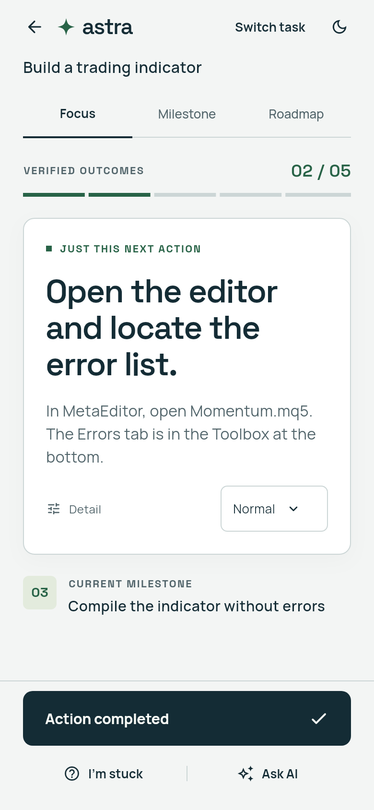 | 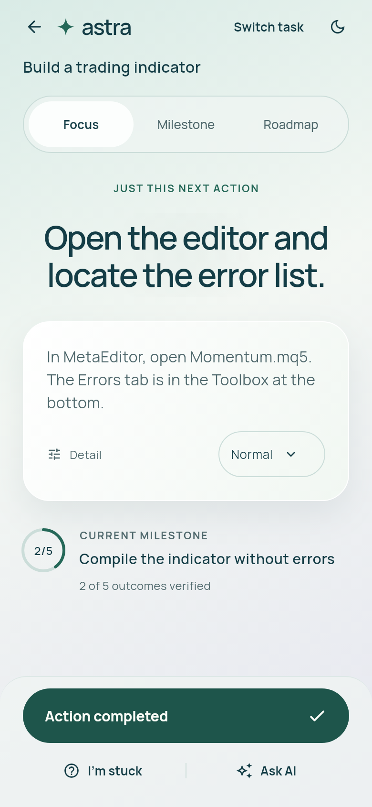 | 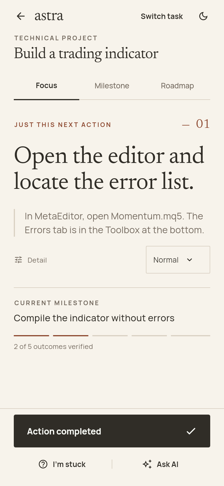 |

## Light · Roadmap

| A — Precision Modern | B — Atmospheric Modern | C — Refined Minimalism |
| --- | --- | --- |
| 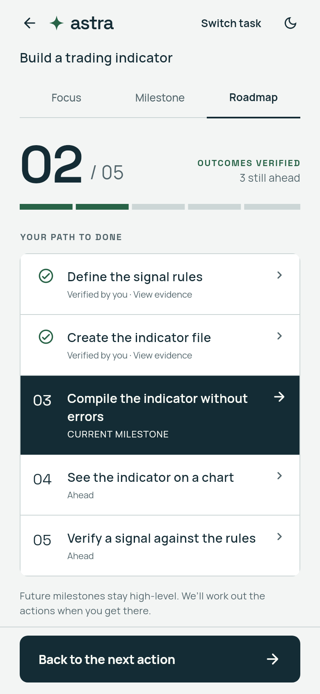 | 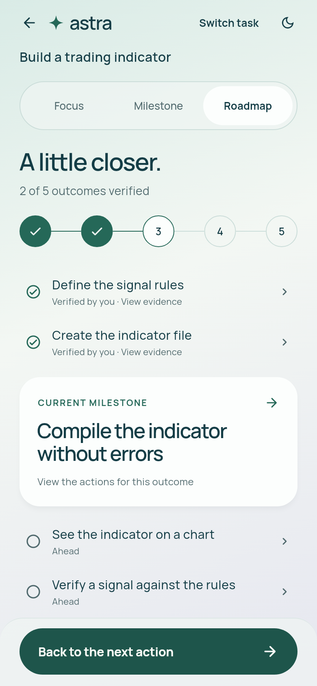 | 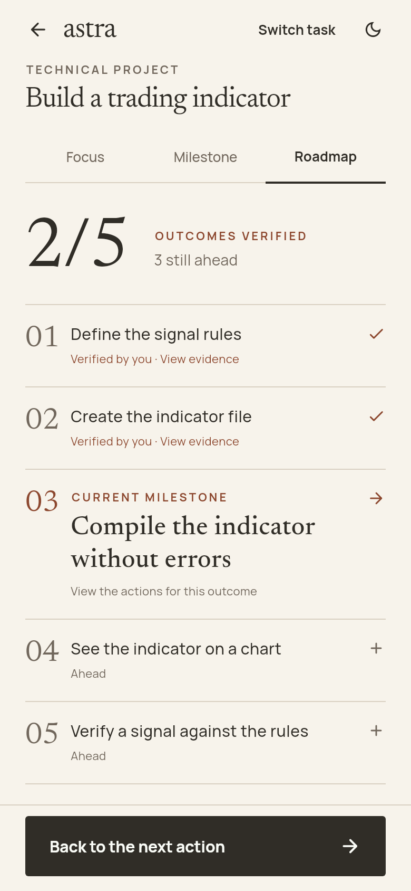 |

## Dark · Focus

| A — Precision Modern | B — Atmospheric Modern | C — Refined Minimalism |
| --- | --- | --- |
| 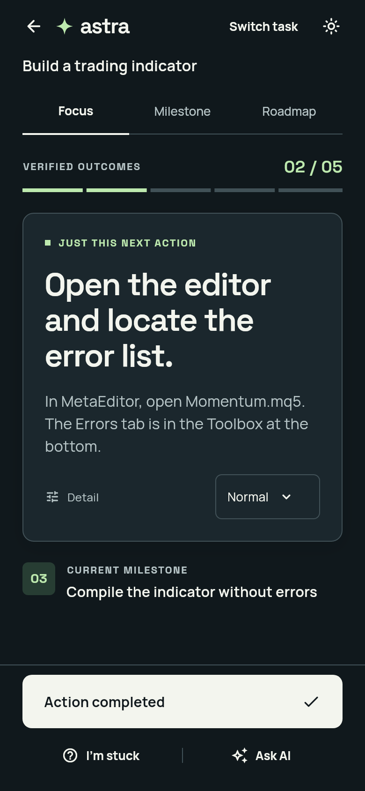 | 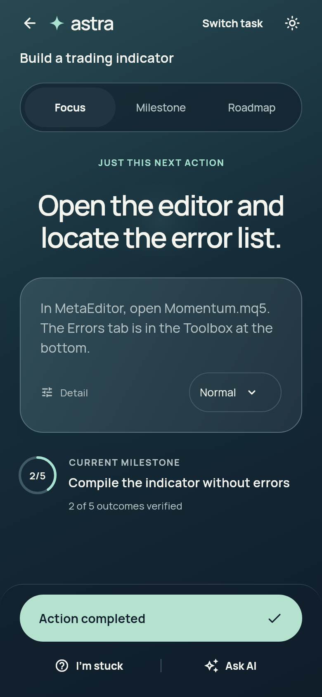 | 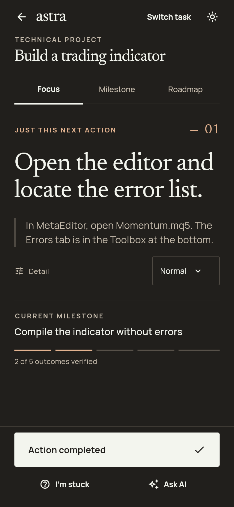 |

## Dark · Roadmap

| A — Precision Modern | B — Atmospheric Modern | C — Refined Minimalism |
| --- | --- | --- |
| 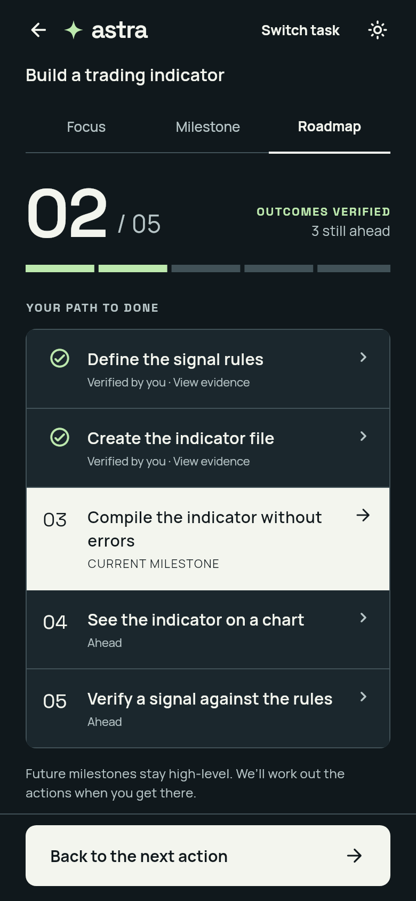 | 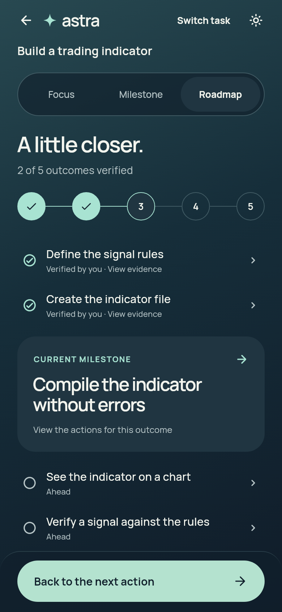 | 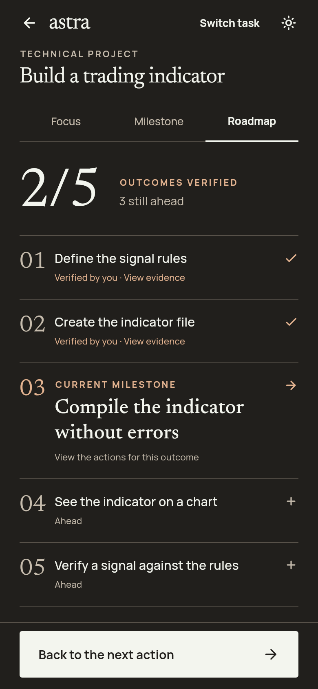 |

## What changes between directions

| | A — Precision Modern | B — Atmospheric Modern | C — Refined Minimalism |
| --- | --- | --- | --- |
| Structure | Inset action panel; continuous outcome ledger | Open, centered action stage; floating instruction surface; horizontal journey | Unboxed editorial page; ruled milestone chapters |
| Typography | Space Grotesk display + Manrope | Manrope with a softer display rhythm | Newsreader display + Manrope instructions |
| Progress | Segmented rail; large aligned fraction; inverted current row | Fine outcome arc in Focus; connected outcome stops in Roadmap | Fine ruled segments; large serif fraction; numbered chapters |
| Navigation | Underlined, geometric tabs | Contained pill navigation | Flat, typographic navigation |
| Material | Cool paper, clean edges, subtle inset surface | Sea-glass light / deep-water dark, gentle gradients and soft light | Warm paper / charcoal, rust / pale copper, fine rules |
| Strength | Fast scanning and decisive hierarchy | Warmth, depth and continuity | Calm reading and a distinctive editorial identity |
| Risk | Can feel formal or utilitarian | More visual texture; centered titles need testing with long instructions | Serif display may scan more slowly; restrained affordances need testing |

These are design hypotheses, not results from user research. No direction is presented as the winner.

## Run the interactive Flutter study

From `prototypes/astra`, with Flutter 3.47.7:

```sh
flutter pub get
flutter run -t lib/visual_main.dart
```

The review menu offers all three styles, both initial themes, and both entry screens. Each launch starts from the same local fictional checkpoint. The header theme button changes light/dark during review. The review session is intentionally in memory so trying one concept does not alter another concept’s initial comparison state. The original entry point (`lib/main.dart`) and its SQLite behavior are unchanged.

Within each concept:

- Switch Focus / Milestone / Roadmap; inspect saved evidence or future outcome criteria.
- Change instruction detail via the “Normal” menu.
- Complete an action, Undo it, request AI help, report being stuck, or switch tasks.
- Complete the four sample actions, then explicitly verify the compile outcome. Only verification changes project progress.
- Use existing Coach and Recovery screens to return to the same action. Those screens retain the original Astra visuals.

## Reproduce validation and screenshots

```sh
flutter analyze
flutter test
flutter test test/exploration_test.dart --plain-name 'export twelve' --dart-define=EXPORT_EXPLORATION=true
```

The exploration workflow also packages the comparison gallery. Rendering uses real bundled fonts, Material icons, and normal shadow painting. Screenshots represent the app viewport, without simulated system status/navigation bars.

See [visual QA and limitations](VISUAL_QA.md) for inspection notes and the scope of testing.
